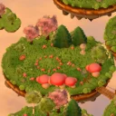

# The Lantern Trail



A small 2.5D storybook RPG. The morning after Lantern Night, a gust of mist scatters five toy friends across Fernhollow, five floating islets above the clouds. Pip has to find them again:
- Momo by the lily pond;
- Nori in a ring of toadstools;
- Juniper behind a riddle;
- Bramble hiding on the summit.

On the way, Pip calms lonely Mistlings in gentle turn-based battles, lights three waystones and wakes Grandma Hazel's beacon so she can find her way home.

**Play:** https://buicongnguyen.github.io/game_RPG/

- About 15 minutes long, in English or Tiếng Việt.
- Controls: touch, mouse, keyboard or gamepad. It saves automatically.
- Battles: hug, share tea, swoop a kite, ask a riddle, raise a lantern shield. Tap as the rings meet for a *Lovely* hug, or as the mist arrives to brace.
- You can't lose. If everyone falls asleep, they wake by the last lit waystone.

It is built to run smoothly on phones. The map was pre-rendered once from 3D models and is drawn with the browser's plain 2D canvas, with no WebGL. It downloads about 1.15 MB and holds 60 fps on a phone profile with the CPU slowed six times. The game began as a mode of [The Lantern Picnic](https://buicongnguyen.github.io/3D_claudeopus55-play/) and shares its characters and Blender kit.

## Develop

```sh
npm install
npm run dev             # http://localhost:4180/  (?debug exposes window.__trail for tests)
npm test                # rules, balance, saves, Vietnamese coverage, bake freshness, map connectivity
npm run test:browser    # with the dev server: phone by touch, the whole story, landscape phone
npm run bake            # re-render the map art from assets/kit (headless Chrome with a GPU, ~20 s)
npm run build           # static site in dist/
npm run deploy          # build and publish dist/ to the gh-pages branch (GitHub Pages)
```

| Path | What it is |
| --- | --- |
| `index.html` · `style.css` | Page, HUD, dialogue, battle panel, menus |
| `src/trail-main.js` | The director: input, exploring, conversations, battles, saves, sound |
| `src/trail-rules.js` | Pure rules: party, Mistlings, battles, fruit, levels, saves |
| `src/trail-map.js` · `trail-grid.js` | Map data shared with the bake, plus the walk grid and pathfinding |
| `src/trail-stage.js` · `critters2d.js` | The Canvas2D renderer and the koi and butterflies |
| `src/trail-script.js` · `trail-vi.js` · `trail-i18n.js` | Story text in English and Vietnamese |
| `src/engine/` | Procedural audio, plus the 3D helpers that only the bake uses |
| `tools/bake/` · `assets/kit/` | The bake and the Blender-built models it renders |
| `assets/trail/` | The baked art the game loads |

How it's built, the measurements and the known limits are in [DESIGN.md](DESIGN.md).
